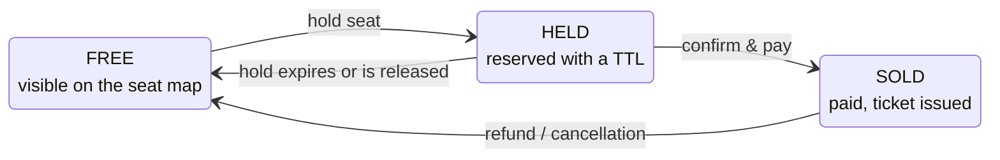

# Constraints

## How to read this document

| Tag        | Meaning                                                                                                                                        |
| ---------- | ---------------------------------------------------------------------------------------------------------------------------------------------- |
| **MUST**   | Explicitly binding for the project: stated as a project requirement, a milestone deliverable, a rule checked at review, or a grading criterion |
| **SHOULD** | Convention or recommendation the course gives for the platform's services; adopt by default, justify deviations in an ADR                      |
| **DOMAIN** | Business rule or invariant of the ticketing domain                                                                                             |
| **INFO**   | Useful fact: sizing figures, versions, scope notes                                                                                             |
| **TODO**   | Open point, still to be defined                                                                                                                |

## Project specifications

### Team, scope & actors

- **MUST** Teams of four students design, implement, operate and document a ticketing platform
- **DOMAIN** The platform serves three kinds of user: organisers, customers and gate staff
- **TODO** Define organiser and gate-staff rules (event creation, pricing) and the Keycloak roles and permissions of each actor
- **INFO** The client is an SPA; frontend frameworks, mobile clients, data engineering and Kubernetes internals are out of scope
- **INFO** In the project, work is parallel: SPA, services and integration are built at the same time, by different people, against the same API

### Architectural constraints

- **MUST** At least three services, each owning its own database schema
- **MUST** No service reads or writes the tables of another one: interaction happens only via APIs or messages; a shared database is ruled out, and everything crossing a boundary is visible in an API or an event
- **MUST** Both stacks are used: at least one service in Kotlin/Spring Boot and one in Rust/Axum
- **MUST** The two stacks of the project express the same domain model
- **MUST** `docker compose up` starts the whole system from a clean checkout
- **MUST** Every API is documented in OpenAPI 3.1, and the document is verified against the implementation in CI
- **SHOULD** Service-to-service calls on the Kotlin side go through `@HttpExchange` interfaces, generated from the callee's OpenAPI document
- **MUST** Live seat-map updates use Server-Sent Events, the platform never needs WebSocket
- **TODO** Define how the SSE seat stream is authenticated (browser `EventSource` cannot send an `Authorization` header)
- **TODO** Define SSE reconnection and resumption (e.g. `Last-Event-ID`) when the serving replica is stopped
- **MUST** In the project, synchronous calls are used on the read and purchase path, asynchronous messages for everything after payment
- **MUST** Application replicas are stateless: no request-specific data kept between requests, no session affinity, any replica can serve any request and be stopped at any time without losing user data; state lives only in backing tiers built for it
- **INFO** In this course a replica is a container started from the service image
- **SHOULD** Large payloads (posters, seating-map bundles, ticket PDFs) live in object storage, not the database

### Required ADRs

- **MUST** The project requires six ADRs: decomposition; stack per service; overselling prevention; one synchronous vs. asynchronous choice; payment flow; one more chosen by the team
- **MUST** Every service boundary is justified by an ADR stating which keep-together/split signal justified it
- **MUST** Each service is responsible for its own API versioning strategy, recorded in an ADR
- **SHOULD** The aggregate-choice ADR (also the lock-scope choice) is "the first one reviewers read"; the reference example is ADR-003 "Hold/order aggregates with DB-enforced seat uniqueness"
- **SHOULD** ADR form: a short (one-page) document kept in the repository next to the code, with context, decision (including rejected alternatives) and consequences

### Mandated infrastructure & toolchains

- **SHOULD** Stack 1: Kotlin 2.3 (baseline of Spring Boot 4.1), Spring Boot 4.1, Spring Framework 7, JDK 25, Gradle with the Kotlin DSL (`build.gradle.kts`)
- **SHOULD** Stack 2: Rust stable, edition 2024, Axum 0.8, Tokio 1.53, SQLx 0.9 (course `Cargo.toml` also pins serde 1, thiserror 2, tracing 0.1)
- **SHOULD** Shared infrastructure: PostgreSQL 18, Keycloak 26.7, Redis, RabbitMQ or Kafka, RustFS (object storage), Prometheus and Grafana, run by a single course `docker-compose.yaml` enabled step by step
- **SHOULD** Rust CI runs `cargo fmt --check`, `cargo audit` and `cargo deny` (CVEs and licence policy) besides clippy `cargo clippy -D warnings`
- **INFO** Contract tooling named in the slides: springdoc-openapi (Spring), utoipa or aide (Axum), oasdiff (change classification), openapi-generator / openapi-typescript (clients)

## Business rules

### Core Business rules

- **MUST** The platform must never sell the same seat twice
- **MUST** The platform must never lose money

### Seat lifecycle

- **DOMAIN** At any instant each seat of a session is in exactly one of FREE, HELD, SOLD, and only the drawn transitions are legal
- **DOMAIN** FREE → HELD is requested by a customer and must be granted to at most one of several concurrent requesters
- **DOMAIN** HELD → SOLD requires a successful payment in an external system
- **DOMAIN** HELD → FREE happens by timeout or release, with no request: server-initiated work
- **DOMAIN** SOLD → FREE (refund) must also reverse the payment: a compensation, i.e. a new action reversing the business effect without deleting history, not an undo
- **DOMAIN** A customer may hold only a bounded number of seats (limit set in configuration), failing with `HoldLimitReached`
- **TODO** Define a race-safe mechanism enforcing the per-customer hold limit (counting active holds before inserting is check-then-act)
- **TODO** Define what happens when a hold expires while its payment is still in progress at the PSP

### Order lifecycle

- **DOMAIN** An order is created as `PENDING`, and has only one state between `PENDING`, `PAID`, `CANCELLED` or `REFUNDED`
- **DOMAIN** Payment: `PENDING` -> `PAID`, set from the synchronous response of the external payment service reporting a successful payment
- **DOMAIN** Cancellation: `PENDING` -> `CANCELLED`, covering every unsuccessful outcome (payment declined or timed out, hold expired or released); the order's held seats are released by the service
- **DOMAIN** Refund: `PAID` -> `REFUNDED`, customer asks for a refund
- **DOMAIN** Illegal transitions are refused: e.g. CANCELLED → PAID never

### Payments

- **DOMAIN** Payments are executed by an external payment service provider (PSP); the platform must stay consistent with it and the purchase flow must stay correct when the PSP is slow, unavailable, or reports results asynchronously and out of order
- **DOMAIN** A retried purchase must never charge the customer twice: the client sends an `Idempotency-Key` with `POST /orders`
- **DOMAIN** PSP webhooks are delivered at least once; a duplicate delivery is discarded by its event identifier
- **TODO** Define where processed webhook event identifiers and idempotency keys are stored, and how their check is atomic across stateless replicas
- **DOMAIN** Ticket issuance follows payment eventually; "order paid and ticket issued" cannot be one cross-service transaction and requires an outbox or saga
- **DOMAIN** Confirmation e-mail, PDF ticket rendering and dashboard updates are deferrable; their failure does not invalidate the order
- **MUST** Money in business logic is amount + currency (ISO 4217 format) in exact form, never floating point: `Money(amount: BigDecimal, currency: Currency)` in Kotlin, `rust_decimal` crate in Rust
- **MUST** Money in storage uses a `NUMERIC` column, with an implicit currency of EUR. Incoming values with currencies other than EUR are automatically converted by business logic
- **MUST** Money on the wire is an object with a string amount and an ISO 4217 currency code: `{"amount": "45.10", "currency": "EUR"}`

### Tickets validation

- **DOMAIN** A ticket is issued for each seat of a paid order
- **DOMAIN** A ticket's first scan (via `POST /tickets/{id}/scans`) admits and marks the ticket as `SCANNED`; every later scan returns the same "already scanned" outcome

## Internal structure of a service

### Layering

- **SHOULD** Layer each service as transport -> framework -> middleware -> handler -> application service -> data access -> local db
- **SHOULD** Handlers are thin: they bind input, call the service and build the response — no business rules, no SQL
- **SHOULD** Application services contain no HTTP concepts
- **SHOULD** Business rules are written once in the service and reused by all entrypoints
- **SHOULD** Repositories take no domain decisions and accept/return domain objects only (never `ResultSet`, `Row` or JPA entity)
- **SHOULD** Keep three type families — wire DTOs (versioned with the API), domain types, persistence types — with plain mapper functions
- **SHOULD** Services receive collaborators already built (Spring container injection; Rust construction in `main` shared via `Arc`); neither creates a repository nor reads the system clock
- **SHOULD** Enforce the dependency rule in the build: ArchUnit/Konsist on the JVM (e.g. "no class in ..service.. may depend on org.springframework.web..", a service importing `jakarta.persistence` breaks the build); in Rust, `pub(crate)` visibility plus clippy, or workspace crates whose domain `Cargo.toml` lists neither axum nor sqlx

## HTTP API design & contracts

### General

- **MUST** Every endpoint passes the six-question API review checklist: URIs name things and verb-like operations create inspectable resources; safety/idempotency respected with no state change on GET; 400/422, 401/403, 404-for-privacy, 409/412 chosen deliberately and no 500 for user errors; unsafe operations safely retryable with a defined, atomic key store; collections with cursors, clamped limit, costed totals and whitelisted sort fields; validators where useful, `no-store` for personal data, a single versioning strategy per service
- **MUST** One naming and casing convention throughout the API: camelCase properties, ISO 8601 timestamps, plural kebab-case paths
- **MUST** OpenAPI style rules enforced at project review: every operation has an `operationId`, every schema and parameter has a `description`, every response carries an `example`
- **MUST** All services use a single error format, RFC 9457 problem documents, in both stacks, and the SPA parses that single format
- **MUST** Timestamps are ISO 8601 with an explicit UTC offset (`OffsetDateTime`, e.g. `2026-09-01T21:00:00+02:00`); timestamps without offset are rejected in requests

### Resources & URIs

- **SHOULD** Plural nouns for collections, kebab-case path segments (`/seat-stream`), identifiers rather than descriptions in paths
- **SHOULD** No verbs in paths (the method is the verb, avoid `/api/getSeats`), and no state-hiding smells such as `/doHold`, `?action=cancel` or a generic `/rpc` endpoint
- **SHOULD** An operation whose result can be queried later is modelled as a resource: `POST /events/{id}/holds` creates a hold with its own URI
- **SHOULD** Consistency across the API: every collection paginates, filters and reports errors the same way
- **SHOULD** The `/api/v1` version prefix is mounted once (`nest("/api/v1", api)`), operational routes such as `/health` stay outside it
- **SHOULD** Unmatched requests get a uniform JSON 404 from a `fallback` handler; a matched path with the wrong method gets 405 with an `Allow` header, as HTTP requires
- **SHOULD** Every operation is either a command or a query, never both (CQS); safe methods such as GET correspond to queries

### Methods & status codes

- **MUST** Nothing that changes state may answer GET (a state-changing GET lets prefetchers and crawlers corrupt state); a method declared idempotent must really tolerate repetitions
- **SHOULD** `DELETE /holds/{id}` is idempotent: a repeated call returns 204 again
- **SHOULD** PUT replaces the whole representation (an omitted field is removed); PATCH uses JSON Merge Patch (RFC 7396: present fields replace, null clears); POST covers creation with server-assigned identity and everything else
- **SHOULD** Create, replace and patch all return the full resulting representation of the resource
- **SHOULD** 2xx contract: 200 with the result in the body; 201 Created with `Location` (e.g. `/api/v1/holds/98213`); 202 Accepted for deferred work with a body telling where progress is observed; 204 No Content (e.g. `DELETE /holds/{id}`)
- **SHOULD** 4xx discipline: 400 for unparseable bodies vs 422 for well-formed but invalid ones (field errors in the body); 401 missing/invalid credentials vs 403 denied; 404 instead of 403 to hide another customer's resource (IDOR); 409 for a clash with current state vs 412 for a failed precondition; 429 with `Retry-After` for rate limits
- **SHOULD** 5xx: 503 with `Retry-After` signals deliberate load shedding; returning 500 for invalid input is a bug
- **MUST** Concurrency outcomes: a hold request for a seat that is already HELD or SOLD maps to 409 Conflict; a general-admission request when capacity is exhausted means sold out, mapped to 409
- **MUST** Always prefer failing fast over waiting on a lock: for seat selection a fast 409 ("seat taken, choose another", seat map refreshed)
- **SHOULD** Spring: return a DTO (200 implied), `ResponseEntity.created(location).body(dto)` for 201, `ResponseEntity.noContent()` for 204; Axum: tuple `(StatusCode::CREATED, [(LOCATION, uri)], Json(dto))`, and a precise return type such as `Result<Json<HoldDto>, AppError>` when the contract should appear in the signature

### Idempotency

- **MUST** Unsafe operations that must be retryable (POST has none of safety, idempotency, cacheability) are made idempotent with the Idempotency-Key protocol
- **SHOULD** The client generates one unique key (a UUID) per logical operation, reuses it on every retry of that attempt, and sends it in the `Idempotency-Key` header
- **SHOULD** The server atomically checks the key: unseen → execute, store the complete response (status and body) with the key and return it; seen and finished → replay the stored response without re-executing; still running → 409 (or wait)
- **SHOULD** A request fingerprint (hash of method, URI, body) is stored with the key; a key reused with a different body is rejected with 422
- **SHOULD** Keys expire and the contract states for how long a retry is safe
- **SHOULD** Handlers bind the key as a typed header (`@RequestHeader("Idempotency-Key") key: String`)

### Caching & conditional requests

- **MUST** Reserved seating exposes optimistic versioning to clients: the row version is sent as an `ETag`, and `If-Match` on the write turns a stale update into 412 Precondition Failed
- **MUST** Holds and orders (personal data) are `no-store`
- **SHOULD** Cache policy via `Cache-Control` (`max-age=300`, `public`, `private`, `no-store`): event details cacheable for minutes, the seat map is not cacheable
- **SHOULD** Conditional reads: `If-None-Match` against the ETag answers 304 Not Modified with an empty body when unchanged
- **SHOULD** Conditional writes: `PUT … If-Match: "v42"`; if another update happened, 412 Precondition Failed and the client re-reads and reapplies its change; a successful write returns the new ETag
- **SHOULD** If an ETag is emitted, the conditional headers must be honoured

### Collections & pagination

- **MUST** Collections use cursor (keyset) pagination with a server-clamped `limit`, whitelisted filter/sort fields and a stated totals policy; no endpoint returns the whole catalogue in one response
- **SHOULD** The cursor is opaque: clients store and echo it, never parse or build it
- **SHOULD** `limit` is clamped by the server and the contract states the maximum (e.g. 500 requested, 200 served)
- **SHOULD** Collection responses use a body envelope `{"items": [...], "nextCursor": ..., "limit": ...}`. `nextCursor` is null on the last page
- **SHOULD** The contract states whether `totalCount` is exact (`COUNT(*)` per page), on request (`?include=total`), an estimate, or absent; a common compromise counts at most 1 001 rows and reports "more than 1 000"
- **SHOULD** OFFSET pagination is acceptable only for shallow navigation over small, stable data (e.g. back-office), never the public event list

### Media types & bodies

- **SHOULD** JSON (`application/json`) is the default; besides it, tickets are `application/pdf`, sales exports `text/csv`, the seat stream `text/event-stream`, errors `application/problem+json`
- **SHOULD** Accepted request bodies: JSON, form encoding (`application/x-www-form-urlencoded`, e.g. OAuth flows) and `multipart/form-data` (file uploads)
- **SHOULD** Every endpoint declares the media types it produces and consumes, recorded per operation in OpenAPI; unmatched `Accept`/`Content-Type` yields 406/415
- **SHOULD** The API is token-based and does not read cookies

### Cross-cutting headers

- **SHOULD** CORS policy is part of the API contract, enforced in the application with one central configuration per service (Spring `WebMvcConfigurer`, Axum `CorsLayer`; `@CrossOrigin` only for local exceptions): exact origins from typed configuration differing between dev and prod, methods GET/POST/PUT/PATCH/DELETE, allowed request headers `Authorization`, `Content-Type`, `Idempotency-Key`, `If-Match`, `If-None-Match`, `X-Request-Id`, exposed response headers `ETag`, `Location`, `Retry-After`, `X-Request-Id`, `Access-Control-Max-Age` to cache preflights
- **SHOULD** Under overload, admission is bounded and the excess is refused immediately with 429/503 + `Retry-After` so clients can retry with backoff

## Resilience

### General

- **SHOULD** Apply the five boundary patterns: timeouts, retries, circuit breakers, bulkheads, graceful degradation
- **SHOULD** Circuit breaker wraps all calls to a dependency: Closed (failures counted over a sliding window) → Open when the failure rate exceeds a threshold (calls rejected with 503 for a cool-down, without reaching the dependency) → Half-open (few probe calls; success closes, failure re-opens)
- **SHOULD** Bulkhead: each dependency gets its own resource pool (a slow PSP must not consume the threads serving the seat map); Spring `@ConcurrencyLimit` bounds concurrent outbound calls
- **SHOULD** Never rely on an unbounded queue (the worst and default option); the only sound responses to overload are bounded queues with immediate rejection (backpressure), load shedding of optional work, and timeouts
- **TODO** Define timeout, retry and circuit-breaker values, and SLO targets

## Request parsing

### Limits before the handler

- **SHOULD** The server enforces limits before any handler runs — maximum body size, maximum number of headers, read timeouts (DoS protection)
- **SHOULD** Stack mechanisms: Spring `spring.servlet.multipart.max-file-size`/`max-request-size` plus a server-level limit; Axum `DefaultBodyLimit` (2 MB default) and `RequestBodyLimitLayer` per route (example `64 * 1024`)
- **SHOULD** Parse, don't validate: convert input once at the boundary into narrow types that only represent legal values

### Strictness policy

- **SHOULD** Strict requests, tolerant responses: the strictness policy is answered once, globally, as configuration
- **SHOULD** Unknown fields are rejected with 400/422 (`#[serde(deny_unknown_fields)]`, Jackson fail-on-unknown-properties)
- **SHOULD** No implicit coercion between JSON types (no `"42"` for an integer, no `1`/`"true"` for a boolean)
- **SHOULD** Missing, null and absent are distinct request cases (PATCH depends on it; use a presence wrapper / `Option<Option<T>>`, or offer PUT instead)

## Service layer

### Domain model, invariants and aggregates

- **SHOULD** Avoid an anaemic model: single-object invariants belong on the entity (`hold.isActive(clock)`, `order.cancel(now)`), while rules spanning several objects or needing ports (per-customer hold limit) stay in the service
- **SHOULD** Domain objects and services accept only precise types (newtypes with smart constructors: `SeatId`, `Quantity`, `Email`); the DTO->domain mapper parses loose DTO types into them, and value objects are used in all signatures
- **SHOULD** Domain types enforce invariants and know nothing about JSON or SQL
- **SHOULD** Aggregates are small and reference each other by identifier; invariants inside one aggregate are enforced in one transaction, only eventual consistency (events) holds between aggregates, and ideally a transaction touches a single aggregate

### Ports, adapters and repositories

- **SHOULD** The core defines ports in domain terms (`HoldRepository`, `EventPublisher`, `Clock`, `PaymentGateway`), and technology-specific adapters (`PgHoldRepository`, broker publisher, in-memory fake) implement them; dependencies point inwards
- **SHOULD** Repository methods are named after domain questions (`findActiveBy(customer)`, `seatPage(event, cursor)`) and still make sense if the UI were replaced; avoid derived-name chains and one-method-per-screen
- **SHOULD** Time and identifiers are injected ports: a `Clock` bean (`Clock.systemUTC()` in production, `Clock.fixed(…)`/`FixedClock` in tests) and an id generator, so expiry is tested deterministically at the deadline and ±1 s; never `Instant.now()`/`Uuid::new_v4()` inside a service
- **SHOULD** Services are unit-tested with hand-written fakes of ports (e.g. `InMemoryHoldRepository`), with no server and no database; the real adapter is tested against real PostgreSQL

## Transactions

### Implementation

- **SHOULD** Prefer `FOR NO KEY UPDATE` over `FOR UPDATE` when key columns are not updated
- **SHOULD** In Rust, the service opens `pool.begin()` and repositories take `&mut Transaction` (never `&PgPool`), so they cannot open their own; `tx.commit()` is the only path that persists, and any early return, `?` or cancellation drops the value and rolls back
- **SHOULD** Keep in mind the `@Transactional` traps: self-invocation bypasses the proxy (put the boundary on another bean's method); checked exceptions commit by default (declare `rollbackFor`); without `@Transactional` each repository call commits alone, reproducing the lost update; never call the PSP inside the transaction

## Performance and capacity

### Release-day profile

- **SHOULD** Anticipate the failure sequence (pool saturates → requests queue → latency grows → clients time out and retry → retries amplify load) with bounded queues, load shedding, admission control and waiting rooms, and an idempotent purchase path; load-test this profile
- **SHOULD** The database fails first (pool saturation, lock contention on hot seat rows); replicas multiply cheaply, the primary does not — so protect it: cache reads, queue deferrable writes, admit only what it can handle
- **SHOULD** Each tier protects the one below: "cached at the top, queued in the middle, admitted at the bottom"; a properly configured CDN absorbs static/cacheable reads and fails last

### Latency
- **SHOULD** Report latency as percentiles (p50, p95, p99), never as a mean alone; dashboards based on means are not trusted; state testable targets (e.g. "p99 below 200 ms at 5 000 req/s")
- **SHOULD** Measure connection setup (DNS, TCP, TLS) before blaming application code; reuse keep-alive connections; HTTP/2 browser↔proxy, HTTP/1.1 proxy↔application
- **INFO** Indicative hold-request budget: warm connection ~15–60 ms (middleware + handler ~5–15 ms, SQL + pool ~5–30 ms, serialise ~1–15 ms); on release day the pool queue feels the spike first

## Security

### Authentication
- **MUST** Keycloak provides identity (OIDC) as standard project infrastructure
- **SHOULD** Every service verifies the JWT on every hop — the gateway is not a trust boundary; the edge also rejects requests without a valid token before they consume capacity
- **SHOULD** Bearer JWTs issued by Keycloak are verified by signature, carrying the caller identity, with no session store on the hot path
- **SHOULD** Authentication runs in application middleware (TLS terminates at the edge with certificates managed in one place)
- **SHOULD** OpenAPI declares the `bearerAuth` scheme (JWT in `Authorization`) globally, overridden per operation.
- **SHOULD** 401 when credentials are missing/invalid (logged at INFO and counted as a security signal); 403 when the caller is known but denied (WARN with principal)
- **SHOULD** Secrets are never committed nor placed in the image; they are injected at deployment time; Rust dev uses a `.env` (dotenvy) with only `.env.example` committed

## Observability

### Correlation / request IDs

- **SHOULD** Every request gets a correlation id (`X-Request-Id`, reusing the caller's or a new UUID) by the outermost middleware, before tracing, returned on the response, and attached to every log record and to error responses (header or `instance`)
- **SHOULD** Spring: request-id filter extends `OncePerRequestFilter`, is registered early (before the security chain), puts the id in MDC and removes it in `finally` (pooled threads); coroutines need `MDCContext`
- **SHOULD** Axum layer order: `SetRequestIdLayer` outermost, `TraceLayer` (one span per request carrying the id), `TimeoutLayer` inside tracing so cancelled requests stay visible, `PropagateRequestIdLayer` on the way out; for each adjacent pair it must be clear what swapping would lose

### Logs
- **SHOULD** Logs go to stdout as structured JSON with correlation identifiers
- **SHOULD** Log levels: DEBUG expected events, INFO notable-normal, WARN suspicious, ERROR only when an operator must act (ERROR is an alerting budget)
- **SHOULD** Bugs/panics/uncaught exceptions: ERROR log with full trace and correlation id inside, only the class outside (Spring catch-all `@ExceptionHandler(Exception::class)`; Axum `CatchPanicLayer`); database causes logged with `tracing::error!` and hidden from the body

### Health endpoints
- **SHOULD** Liveness answers "restart the process?" (false on deadlock/corrupt state) and never checks the database; readiness answers "send traffic?" (false while starting, draining, or a critical dependency is down) and only removes the replica from load balancing
- **SHOULD** Spring: enable probes (`management.endpoint.health.probes.enabled=true` → `/actuator/health/liveness`, `/actuator/health/readiness`); the DB indicator belongs to readiness only
- **SHOULD** A replica becomes ready in seconds; one still migrating is alive but not ready

## Configuration

- **SHOULD** Configuration is externalised, typed, validated and fail-fast: an invalid value stops the boot naming the offending key, before the pool is created and the listener bound (e.g. a wrong hold TTL must stop the deployment, not produce anomalous holds at the peak)
- **SHOULD** Spring: `@ConfigurationProperties(prefix = "tickets")` + `@Validated` with Jakarta constraints, cross-field rules in `init { require(...) }`, discovered by `@ConfigurationPropertiesScan`
- **SHOULD** Rust: figment merges committed `config/default.toml` with `Env::prefixed("TICKETS_").split("__")` (`TICKETS_HOLD_TTL` → `hold_ttl`); `validate()` right after `extract()`; `TicketingConfig::load()?` in `main`
- **SHOULD** Profiles (`dev`, `test`, `prod`) are activated from outside via `SPRING_PROFILES_ACTIVE`, never hard-coded; precedence: command line > env vars > profile YAML > `application.yaml`; relaxed binding lets Compose/Kubernetes `environment:` configure the app without changing the image
- **SHOULD** One build artefact serves every environment; every environment-specific value comes from outside it
- **INFO** Operational values such as hold TTL, per-customer hold limit, idempotency-key retention and maximum pagination `limit` are defined in configuration, not in these requirements
