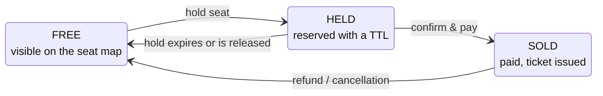

# Contstraints

## How to read this document

| Tag        | Meaning                                                                                                                                        | Count |
| ---------- | ---------------------------------------------------------------------------------------------------------------------------------------------- | ----- |
| **MUST**   | Explicitly binding for the project: stated as a project requirement, a milestone deliverable, a rule checked at review, or a grading criterion | 98    |
| **SHOULD** | Convention or recommendation the course gives for the platform's services; adopt by default, justify deviations in an ADR                      | 618   |
| **DOMAIN** | Business rule or invariant of the ticketing domain                                                                                             | 76    |
| **INFO**   | Useful fact: sizing figures, versions, scope notes                                                                                             | 35    |

## Project specifications

### Team, scope & actors

- **MUST** Teams of four students design, implement, operate and document a ticketing platform
- **MUST** Both business rules must hold under concurrent load: the platform never sells the same seat twice, and never loses money
- **DOMAIN** The platform serves three kinds of user: organisers, customers and gate staff
- **INFO** The client is an SPA, frontend frameworks, mobile clients, data engineering and Kubernetes internals are out of scope
- **INFO** In the project, work is parallel: SPA, services and integration are built at the same time, by different people, against the same API

### Architectural constraints

- **MUST** At least three services, each owning its own database schema
- **MUST** No service reads or writes the tables of another one: interaction happens only via APIs or messages; a shared database is ruled out, and everything crossing a boundary is visible in an API or an event
- **MUST** Both stacks are used: at least one service in Kotlin/Spring Boot and one in Rust/Axum
- **MUST** The two stacks of the project express the same domain model
- **MUST** Standard infrastructure: Keycloak provides identity, and `docker compose up` starts the whole system from a clean checkout
- **MUST** Every API is documented in OpenAPI 3.1, and the document is verified against the implementation in CI
- **MUST** Three OpenAPI style rules are enforced at project review: every operation has an `operationId` (it names the generated method); every schema and parameter has a description; every response carries an example (used by reviewers and mock servers)
- **SHOULD** Service-to-service calls on the Kotlin side go through `@HttpExchange` interfaces, generated from the callee's OpenAPI document
- **MUST** All services use the same error format, RFC 9457 problem documents, in both languages
- **MUST** Live seat-map updates use Server-Sent Events, the platform never needs WebSocket
- **MUST** In the project, synchronous calls are used on the read and purchase path, asynchronous messages for everything after payment
- **MUST** Application replicas are stateless: no request-specific data kept between requests, no session affinity, any replica can serve any request and be stopped at any time without losing user data; state lives only in backing tiers built for it
- **INFO** In this course a replica is a container started from the service image
- **SHOULD** Large payloads (posters, seating-map bundles, ticket PDFs) live in object storage, not the database

### Required ADRs

- **MUST** The project requires six ADRs: decomposition; stack per service; overselling prevention; one synchronous vs. asynchronous choice; payment flow; one more chosen by the team
- **MUST** Every service boundary is justified by an ADR stating which keep-together/split signal justified it
- **MUST** The system adopts a single API versioning strategy, chosen at the gateway and recorded in an ADR
- **SHOULD** The aggregate-choice ADR (also the lock-scope choice) is "the first one reviewers read"; the reference example is ADR-003 "Hold/order aggregates with DB-enforced seat uniqueness"
- **SHOULD** ADR form: a short (one-page) document kept in the repository next to the code, with context, decision (including rejected alternatives) and consequences

### Mandated infrastructure & toolchains

- **SHOULD** Stack 1: Kotlin 2.3 (baseline of Spring Boot 4.1), Spring Boot 4.1, Spring Framework 7, JDK 25, Gradle with the Kotlin DSL (`build.gradle.kts`)
- **SHOULD** Stack 2: Rust stable, edition 2024, Axum 0.8, Tokio 1.53, SQLx 0.9 (course `Cargo.toml` also pins serde 1, thiserror 2, tracing 0.1)
- **SHOULD** Shared infrastructure: PostgreSQL 18, Keycloak 26.7, Redis, RabbitMQ or Kafka, Prometheus and Grafana, run by a single course `docker-compose.yaml` enabled step by step
- **SHOULD** Rust CI runs `cargo fmt --check`, `cargo audit` and `cargo deny` (CVEs and licence policy) besides clippy `cargo clippy -D warnings`
- **INFO** Contract tooling named in the slides: springdoc-openapi (Spring), utoipa or aide (Axum), oasdiff (change classification), openapi-generator / openapi-typescript (clients)
- **SHOULD** Object storage service is provided by `RustFS`

## Business rules

### Core Business rules

- **MUST** The platform must never sell the same seat twice
- **MUST** The platform must never lose money

### Seat lifecycle

- **DOMAIN** At any instant each seat of a session is in exactly one of FREE, HELD, SOLD, and only the drawn transitions are legal
- **DOMAIN** FREE → HELD is requested by a customer and must be granted to at most one of several concurrent requesters
- **DOMAIN** HELD → SOLD requires a successful payment in an external system
- **DOMAIN** HELD → FREE happens by timeout or release, with no request: server-initiated work
- **DOMAIN** SOLD → FREE (refund) must also reverse the payment: a compensation, i.e. a new action reversing the business effect without deleting history, not an undo
- **DOMAIN** A customer may hold only a bounded number of seats, enforced by counting the customer's active holds, failing with `HoldLimitReached`

### Order lifecycle

- **DOMAIN** An order is created as `PENDING`, and has only one state between `PENDING`, `PAID`, `CANCELLED` or `REFUNDED`
- **DOMAIN** Payment: `PENDING` -> `PAID`, the user succesfully completed the payment through the external payment service
- **DOMAIN** Cancellation: `PENDING` -> `CANCELLED`, an order's held seat is released by the service
- **DOMAIN** Refund: `PAID` -> `REFUNDED`, customer asks for a refund
- **DOMAIN** Illegal transitions are refused: e.g. CANCELLED → PAID never

### Payments

- **DOMAIN** Payments are executed by an external payment service provider (PSP); the platform must stay consistent with it and the purchase flow must stay correct when the PSP is slow, unavailable, or reports results asynchronously and out of order
- **DOMAIN** A retried purchase must never charge the customer twice: the client sends an `Idempotency-Key` with `POST /orders`
- **DOMAIN** PSP webhooks are delivered at least once; a duplicate delivery is discarded by its event identifier
- **DOMAIN** Ticket issuance follows payment eventually; "order paid and ticket issued" cannot be one cross-service transaction and requires an outbox or saga
- **DOMAIN** Confirmation e-mail, PDF ticket rendering and dashboard updates are deferrable; their failure does not invalidate the order
- **MUST** Money in business logic is amount + currency (ISO 4217 format) in exact form, never floating point: `Money(amount: BigDecimal, currency: Currency)` in Kotlin, `rust_decimal` crate in Rust
- **MUST** Money in storage uses a `NUMERIC` column, with an implicit currency of EUR
- **MUST** Money on the wire is an object with a string amount and an ISO 4217 currency code: `{"amount": "45.10", "currency": "EUR"}`

### Tickets validation

- **DOMAIN** A ticket is issued for each seat of a paid order
- **DOMAIN** A ticket's first scan (via `POST /tickets/{id}/scans`) admits and marks the ticket as `SCANNED`; every later scan returns the same "already scanned" outcome

## Internal structure of a service

### Layering

- **SHOULD** Layer each service as transport -> framework -> middleware -> handler -> application service -> data access -> local db
- **SHOULD** Handlers are thin: they bind input, call the service and build the response — no business rules, no SQL
- **SHOULD** Application services contain no HTTP concepts
- **SHOULD** Business rules are written once in the service and reused by all entrypoints
- **SHOULD** Ports and adapters: the core defines ports in domain terms (`HoldRepository`, `EventPublisher`, `Clock`, `PaymentGateway`) and never imports a database or transport library; adapters (e.g. `PgHoldRepository`, broker publisher, in-memory map for tests) are replaceable without touching rules
- **SHOULD** Repositories take no domain decisions and accept/return domain objects only (never `ResultSet`, `Row` or JPA entity)
- **SHOULD** Keep three type families — wire DTOs (versioned with the API), domain types, persistence types — with plain mapper functions
- **SHOULD** Services receive collaborators already built (Spring container injection; Rust construction in `main` shared via `Arc`); neither creates a repository nor reads the system clock
- **SHOULD** Enforce the dependency rule in the build: ArchUnit/Konsist on the JVM (e.g. "no class in ..service.. may depend on org.springframework.web..", a service importing `jakarta.persistence` breaks the build); in Rust, `pub(crate)` visibility plus clippy, or workspace crates whose domain `Cargo.toml` lists neither axum nor sqlx

## HTTP API design & contracts

- **MUST** Every endpoint passes the six-question API review checklist: URIs name things and verb-like operations create inspectable resources; safety/idempotency respected with no state change on GET; 400/422, 401/403, 404-for-privacy, 409/412 chosen deliberately and no 500 for user errors; unsafe operations safely retryable with a defined, atomic key store; collections with cursors, clamped limit, costed totals and whitelisted sort fields; validators where useful, `no-store` for personal data, a single versioning strategy
- **MUST** One naming and casing convention throughout the API: camelCase properties, ISO 8601 timestamps, plural kebab-case paths
- **MUST** OpenAPI style rules enforced at project review: every operation has an `operationId`, every schema and parameter has a `description`, every response carries an `example`
- **MUST** All services use a single error format, RFC 9457 problem documents, in both stacks, and the SPA parses that single format

### Resources & URIs

- **SHOULD** Plural nouns for collections, kebab-case path segments (`/seat-stream`), identifiers rather than descriptions in paths
- **SHOULD** No verbs in paths (the method is the verb, avoid `/api/getSeats`), and no state-hiding smells such as `/doHold`, `?action=cancel` or a generic `/rpc` endpoint
- **SHOULD** An operation whose result can be queried later is modelled as a resource: `POST /events/{id}/holds` creates a hold with its own URI
- **SHOULD** Consistency across the API: every collection paginates, filters and reports errors the same way
- **SHOULD** The `/api/v1` version prefix is mounted once (`nest("/api/v1", api)`), operational routes such as `/health` stay outside it
- **SHOULD** Unmatched requests get a uniform JSON 404 from a `fallback` handler; a matched path with the wrong method gets 405 with an `Allow` header, as HTTP requires
- **SHOULD** Every operation is either a command or a query, never both (CQS); safe methods such as GET correspond to queries

### Methods & status codes

- **MUST** Nothing that changes state may answer GET (a state-changing GET lets prefetchers and crawlers corrupt state); a method declared idempotent must really tolerate repetitions
- **SHOULD** `DELETE /holds/{id}` is idempotent: a repeated call returns 204 again
- **SHOULD** PUT replaces the whole representation (an omitted field is removed); PATCH uses JSON Merge Patch (RFC 7396: present fields replace, null clears); POST covers creation with server-assigned identity and everything else
- **SHOULD** Create, replace and patch all return the full resulting representation of the resource
- **SHOULD** 2xx contract: 200 with the result in the body; 201 Created with `Location` (e.g. `/api/v1/holds/98213`); 202 Accepted for deferred work with a body telling where progress is observed; 204 No Content (e.g. `DELETE /holds/{id}`)
- **SHOULD** 4xx discipline: 400 for unparseable bodies vs 422 for well-formed but invalid ones (field errors in the body); 401 missing/invalid credentials vs 403 denied; 404 instead of 403 to hide another customer's resource (IDOR); 409 for a clash with current state vs 412 for a failed precondition; 429 with `Retry-After` for rate limits
- **SHOULD** 5xx: 503 with `Retry-After` signals deliberate load shedding; returning 500 for invalid input is a bug
- **MUST** Concurrency outcomes as adopted by the project: a unique-constraint violation (SQLSTATE 23505) on holds maps to 409 Conflict; general admission with 0 rows affected by the conditional counter UPDATE means sold out, mapped to 409
- **SHOULD** For seat selection a fast 409 ("seat taken, choose another", seat map refreshed) is preferred over waiting on a lock
- **SHOULD** Spring: return a DTO (200 implied), `ResponseEntity.created(location).body(dto)` for 201, `ResponseEntity.noContent()` for 204; Axum: tuple `(StatusCode::CREATED, [(LOCATION, uri)], Json(dto))`, and a precise return type such as `Result<Json<HoldDto>, AppError>` when the contract should appear in the signature

### Idempotency

- **MUST** Unsafe operations that must be retryable (POST has none of safety, idempotency, cacheability) are made idempotent with the Idempotency-Key protocol
- **SHOULD** The client generates one unique key (a UUID) per logical operation, reuses it on every retry of that attempt, and sends it in the `Idempotency-Key` header
- **SHOULD** The server atomically checks the key: unseen → execute, store the complete response (status and body) with the key and return it; seen and finished → replay the stored response without re-executing; still running → 409 (or wait)
- **SHOULD** A request fingerprint (hash of method, URI, body) is stored with the key; a key reused with a different body is rejected with 422
- **SHOULD** Keys expire and the contract states for how long a retry is safe
- **SHOULD** Handlers bind the key as a typed header (`@RequestHeader("Idempotency-Key") key: String`), and CORS must allow the `Idempotency-Key` request header

### Caching & conditional requests

- **MUST** Reserved seating exposes optimistic versioning to clients: the row version is sent as an `ETag`, and `If-Match` on the write turns a stale update into 412 Precondition Failed
- **MUST** Holds and orders (personal data) are `no-store`
- **SHOULD** Cache policy via `Cache-Control` (`max-age=300`, `public`, `private`, `no-store`): event details cacheable for minutes, the seat map is not cacheable
- **SHOULD** Conditional reads: `If-None-Match` against the ETag answers 304 Not Modified with an empty body when unchanged
- **SHOULD** Conditional writes: `PUT … If-Match: "v42"`; if another update happened, 412 Precondition Failed and the client re-reads and reapplies its change; a successful write returns the new ETag
- **SHOULD** If an ETag is emitted, the conditional headers must be honoured
