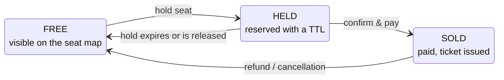

# Constraints: business rules

Tags (**MUST**, **SHOULD**, **DOMAIN**, **INFO**, **TODO**): see [README.md](README.md).

## Business rules

### Core Business rules

- **MUST** [BIZ-01] The platform must never sell the same seat twice
- **MUST** [BIZ-02] The platform must never lose money

### Seat lifecycle

- **DOMAIN** [BIZ-03] At any instant each seat of a session is in exactly one of FREE, HELD, SOLD, and only the drawn transitions are legal
- **DOMAIN** [BIZ-04] FREE → HELD is requested by a customer and must be granted to at most one of several concurrent requesters
- **DOMAIN** [BIZ-05] HELD → SOLD requires a successful payment in an external system
- **DOMAIN** [BIZ-06] HELD → FREE happens by timeout or release, with no request: server-initiated work
- **DOMAIN** [BIZ-07] SOLD → FREE (refund) must also reverse the payment: a compensation, i.e. a new action reversing the business effect without deleting history, not an undo
- **DOMAIN** [BIZ-08] A customer may hold only a bounded number of seats (limit set in configuration), failing with `HoldLimitReached`
- **TODO** [BIZ-09] Define a race-safe mechanism enforcing the per-customer hold limit (counting active holds before inserting is check-then-act)
- **TODO** [BIZ-10] Define what happens when a hold expires while its payment is still in progress at the PSP

### Order lifecycle

- **DOMAIN** [BIZ-11] An order is created as `PENDING`, and has only one state between `PENDING`, `PAID`, `CANCELLED` or `REFUNDED`
- **DOMAIN** [BIZ-12] Payment: `PENDING` -> `PAID`, set from the synchronous response of the external payment service reporting a successful payment
- **DOMAIN** [BIZ-13] Cancellation: `PENDING` -> `CANCELLED`, covering every unsuccessful outcome (payment declined or timed out, hold expired or released); the order's held seats are released by the service
- **DOMAIN** [BIZ-14] Refund: `PAID` -> `REFUNDED`, customer asks for a refund
- **DOMAIN** [BIZ-15] Illegal transitions are refused: e.g. CANCELLED → PAID never

### Payments

- **DOMAIN** [BIZ-16] Payments are executed by an external payment service provider (PSP); the platform must stay consistent with it and the purchase flow must stay correct when the PSP is slow, unavailable, or reports results asynchronously and out of order
- **DOMAIN** [BIZ-17] A retried purchase must never charge the customer twice: the client sends an `Idempotency-Key` with `POST /orders`
- **DOMAIN** [BIZ-18] PSP webhooks are delivered at least once; a duplicate delivery is discarded by its event identifier
- **TODO** [BIZ-19] Define where processed webhook event identifiers and idempotency keys are stored, and how their check is atomic across stateless replicas
- **DOMAIN** [BIZ-20] Ticket issuance follows payment eventually; "order paid and ticket issued" cannot be one cross-service transaction and requires an outbox or saga
- **DOMAIN** [BIZ-21] Confirmation e-mail, PDF ticket rendering and dashboard updates are deferrable; their failure does not invalidate the order
- **MUST** [BIZ-22] Money in business logic is amount + currency (ISO 4217 format) in exact form, never floating point: `Money(amount: BigDecimal, currency: Currency)` in Kotlin, `rust_decimal` crate in Rust
- **MUST** [BIZ-23] Money in storage is a `NUMERIC(12,2)` amount column plus an ISO 4217 currency column
- **MUST** [BIZ-24] Money on the wire is an object with a string amount and an ISO 4217 currency code: `{"amount": "45.10", "currency": "EUR"}`

### Tickets validation

- **DOMAIN** [BIZ-25] A ticket is issued for each seat of a paid order
- **DOMAIN** [BIZ-26] A ticket's first scan (via `POST /tickets/{id}/scans`) admits and marks the ticket as `SCANNED`; every later scan returns the same "already scanned" outcome
