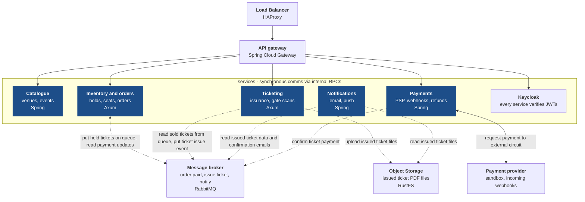

# Ticketing Platform - Group 7 Milestone 1 Document

## Team Members

* Paolo Audenino - S352795
* Amedeo Marino - S358012
* Andrei Daniel Stefan - S356980
* Diana Zappia - S362955

## Domain Scope

### Actors

* Organizers: who publish new events on the ticketing platform, with ticket details, maps and availability;
* Customers: who want to buy a ticket for an event from the ticketing platform;
* Gate Staff: who need to physically scan event customers' tickets at the start of an event;

### Main User Stories

* As an organizer, I want to create a new event on the ticketing platform, defining all the necessary details before the sales starts
* As an organizer, I want to be able to edit the details of an event I own before the start of the sales
* As an organizer, I want to follow my own events' sales through a dashboard
* As a customer, I want to browse available tickets for an event
* As a customer, I want to hold seat(s) until I complete the payment of the respective ticket(s)
* As a customer, I want to buy ticket(s) for an event
* As a customer, I want to receive tickets I bought on my personal email
* As a customer, I want to review past orders on the ticketing platform
* As a customer, I want to ask for a refund for an order I previously bought
* As a gate staff person, I want to scan a customer's ticket to understand if it's valid for the event they're attending

## Service Decomposition

Persistency layer is not shown in this diagram because each service owns its PostgreSQL database and schema: data from service to service is only passed via synchronously RPCs or asynchronously via the message broker.

### Services' Stack Decision

We chose a stack over the other by trying to estimate peaks during the application lifecycle: the 2 most used services are `Inventory and orders`, during an event's sales opening, and `Ticketing`, during the hours preceding the start of an event for ticket scanning. For that reason we decided to stick with Axum for those, as to try and optimize performances and resilience of those services.

While we know Spring has better integrations with the other moving parts, we still prefer to rely on a compiled language, ready to operate at full speed and with no pauses caused by a garbage collector. Memory footprint will also be smaller, without the overhead of the JVM, enabling us to activate more instances of the same service.

As for the rest of the services, they won't, based on our estimations, face as much high intensity traffic, leaving us with the Spring stack. A small exception could be the `catalogue` service, but, given that most operations on it will be read-only (customers browsing available events and plans), its data suits to be heavily cached, removing the primary botteneck, database access. `notification` and `payment` instead will rely on the more mature integrations provided by the Spring framework with email servers and external payment providers.

### Other Components

Because of our previous interaction with the professor and for helping us modelling the system, we also decided to detail a couple more components outside the services: requests' entrypoint, handled by a load balancer put in front of an API gateway, and a message broker along an object storage. We researched what technologies we could use, with the only constraints being they must be self-hostable: no external components such as Cloudflare or AWS technologies. The following is a list of the proposed technologies and a short motivation on why we chose them:

* HAProxy: this is our weakest choice, as noone of us had any experience with load balancers. HA seems to be a good, open and specialized tool for our usecase, but we are absolutely open to suggestions;
* Sprint Cloud Gateway: we decided to go with it to remain under the Spring ecosystem, expecting better integration with Spring services;
* RabbitMQ: again, a choice we're not sure about. Kafka could also be a good fit, but we need to better model our services' interactions to really understand if we need a message broker or an event store.
* RustFS: as suggested by the professor, and one of the main choices for a locally hosted object storage, being compatible with AWS' S3 APIs. Other options are possible, and easily swappable because of compliance to the same standard of APIs.