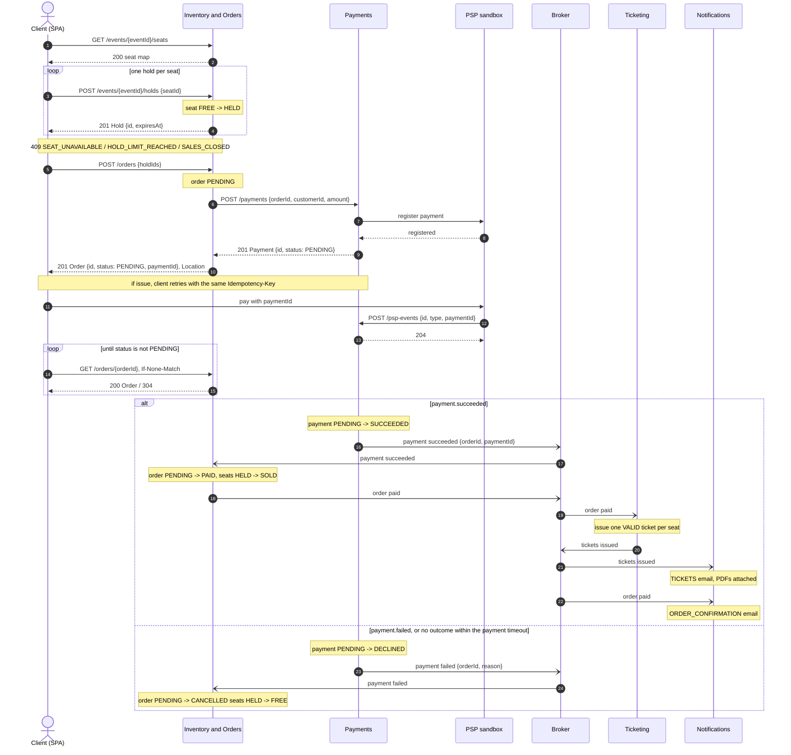

# Purchase flow

Happy path and failure paths of a ticket purchase. Operations are those of the Milestone 2 OpenAPI drafts; every path is mounted under `/api/v1` ([API-10]). Synchronous calls cover the purchase path, asynchronous messages everything after payment ([ARCH-16]). Message names are descriptive: their contract is not defined yet.

